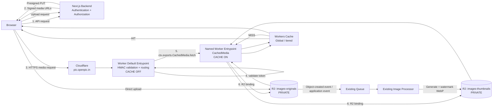
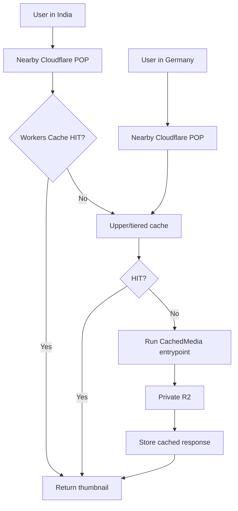
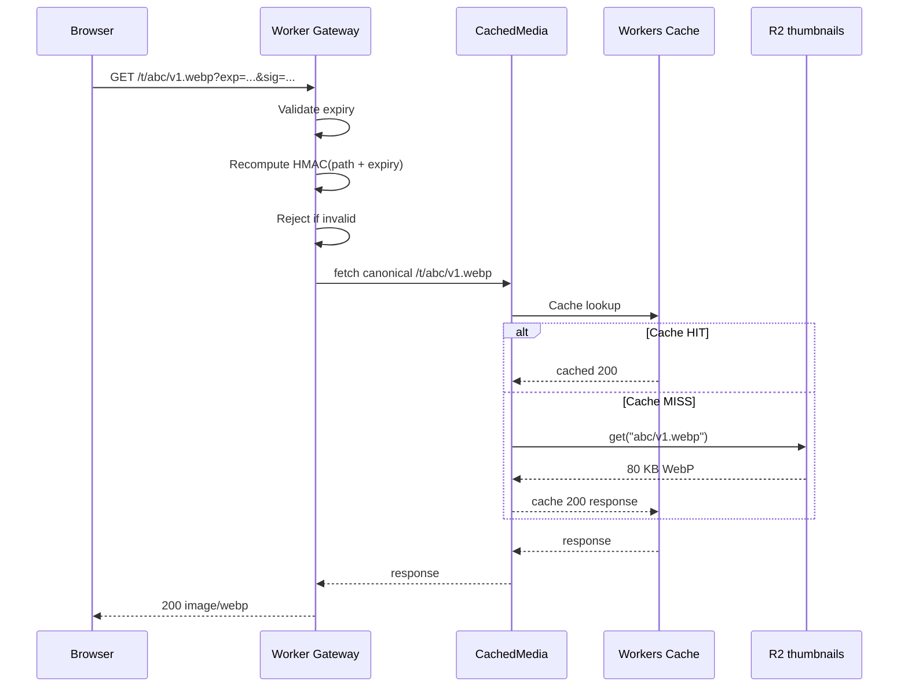
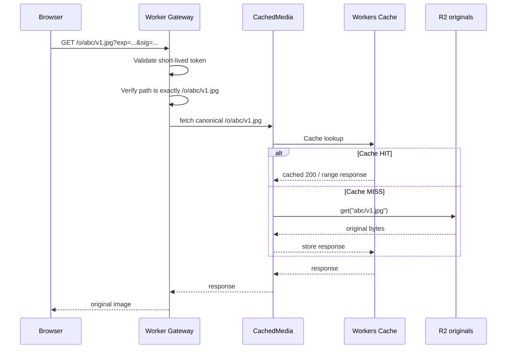
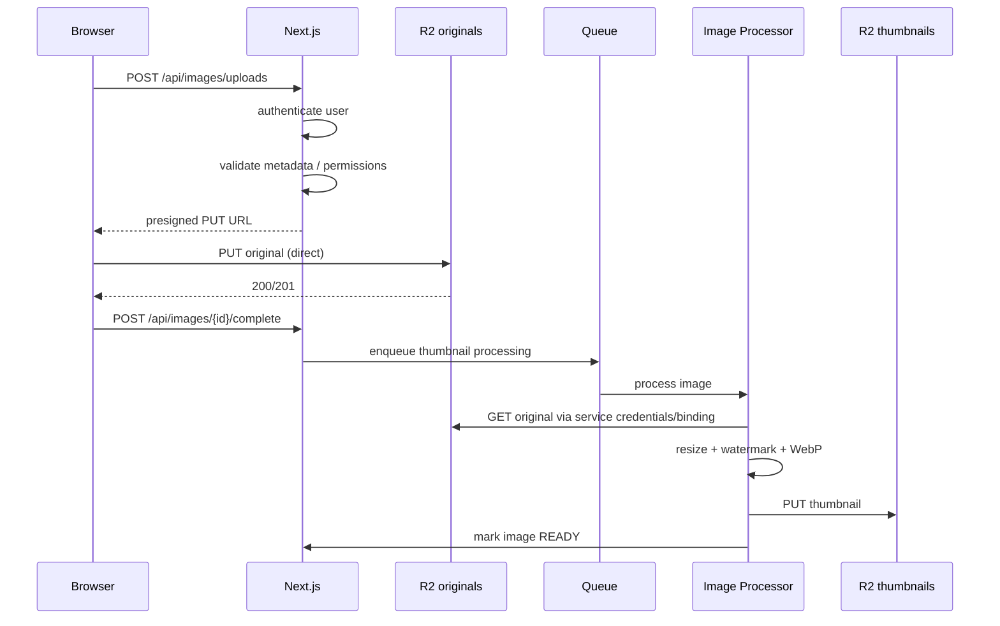
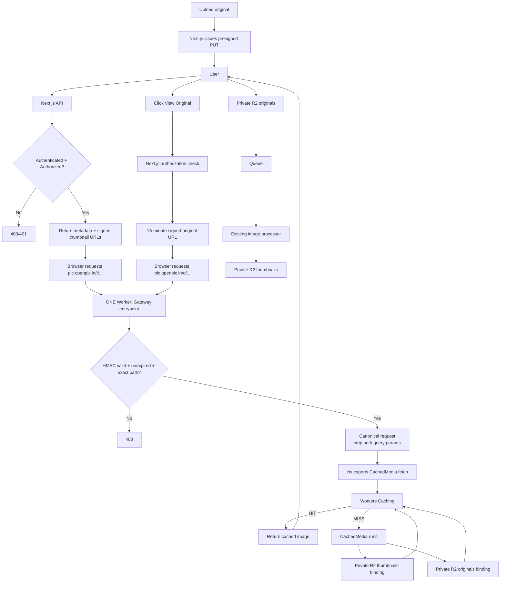

## 1\. Executive decision

The recommended design is:

- Keep **two private Cloudflare R2 buckets**:
    - `images-originals` — the high-quality source images.
    - `images-thumbnails` — pre-generated, watermarked WebP thumbnails.
- Upload originals directly from the browser to the private originals bucket using an **R2 S3-compatible presigned `PUT` URL** issued by the backend.
- Generate thumbnails asynchronously using the existing backend processing/queue infrastructure.
- Serve images through **one Cloudflare Worker** on `pic.openpic.in`.
- Do **not** proxy image bytes through Next.js.
- Authenticate and authorize at the application layer in Next.js, then issue a short-lived **HMAC-signed media URL** for each image the user is allowed to see.
- The Worker validates the HMAC and expiry, strips the authorization parameters, and calls a **cached named Worker entrypoint** through `ctx.exports` using a canonical cache key.
- The named entrypoint reads the object from the private R2 bucket using an R2 binding.
- Use **Workers Caching**, not `caches.default`, for the image response so the cache participates in Cloudflare's current tiered/global Workers Cache architecture.
- Keep thumbnail cache freshness at approximately **31 days** and original cache freshness at approximately **7 days**, using Cloudflare-specific cache-control headers. Treat these as freshness targets, **not a guarantee that every POP retains an object for that entire period**. Cloudflare says cache retention is not configurable and objects may be evicted before their TTL based on popularity and cache capacity.

This design keeps the source buckets private while allowing the actual image bytes to bypass Next.js and be served from Cloudflare's edge cache.

* * *

## 2\. Why this architecture was selected

### 2.1 One Worker instead of two Workers

Cloudflare Workers Caching now supports per-entrypoint caching and an explicit gateway pattern. The default/gateway entrypoint can have caching disabled, while a named `WorkerEntrypoint` can have caching enabled. A gateway can invoke the cached entrypoint with `ctx.exports`; the invocation is evaluated through the cache. Cloudflare documents this as the recommended way to build a gateway that authenticates/normalizes requests while keeping the reusable response cached independently.

Sources:

- https://developers.cloudflare.com/workers/cache/configuration/
- https://3b21a3e4.previews.developers.cloudflare.com/workers/cache/examples/

### 2.2 Why not `caches.default`

Do **not** use the legacy Workers Cache API (`caches.default`) as the primary image cache for this design. Cloudflare's Runtime Cache API documentation states that this cache is scoped to the data center where the Worker runs and does not provide the same global/tiered behavior. The newer Workers Caching system is the better fit for the requested global CDN behavior.

Sources:

- https://developers.cloudflare.com/workers/runtime-apis/cache/
- https://developers.cloudflare.com/workers/cache/configuration/
- https://3b21a3e4.previews.developers.cloudflare.com/workers/cache/examples/

* * *

# 3\. High-level architecture



The direction of the image response is deliberately:

```text
Browser
  ↓
Cloudflare Worker
  ↓
Workers Cache
  ↓ (only on cache miss)
Private R2
```

Next.js does **not** sit in the image-byte path.

* * *

# 4\. Components and responsibilities

## 4.1 Next.js backend

### Responsibilities

- Authenticate the application user.
- Authorize access to a gallery/image/tenant/project.
- Generate upload presigned URLs for original uploads.
- Return image metadata and signed media URLs.
- Generate HMAC signatures for media URLs.
- Generate an original-image URL only when the user is authorized to retrieve the original.
- Manage image records and processing state in the application database.

### It should NOT

- stream thumbnails through Next.js;
- stream originals through Next.js;
- make an internal HTTP request for every displayed image;
- expose R2 credentials to the browser.

* * *

## 4.2 R2 `images-originals`

Stores only original/high-quality files.

Example:

```text
images-originals/
  images/
    <image-id>/
      v1.jpg
```

This bucket remains private.

The browser only receives a presigned `PUT` URL during upload. Normal image viewing should not use a direct R2 S3 URL.

Cloudflare's R2 documentation says buckets are not publicly accessible by default. Public access is an explicit configuration. R2 supports direct Worker bindings for internal access.

Source:

- https://developers.cloudflare.com/r2/buckets/public-buckets/
- https://developers.cloudflare.com/r2/api/workers/workers-api-reference/

* * *

## 4.3 R2 `images-thumbnails`

Stores the final delivery thumbnail.

Example:

```text
images-thumbnails/
  thumbs/
    <image-id>/
      v1.webp
```

Suggested starting image output:

- WebP
- around 600 px on the long side
- quality around 40–50
- watermark included
- target average: 30–70 KB

The 30–70 KB range should be treated as a target, not a guaranteed exact size. Highly detailed images can still exceed it at the same dimensions/quality.

* * *

## 4.4 Existing queue + processor

The existing queue is used for asynchronous derivative generation.

The processing job should:

1.  Verify that the original upload is present.
2.  Validate MIME type and image integrity.
3.  Read dimensions/metadata.
4.  Resize to the configured thumbnail dimensions.
5.  Add the watermark.
6.  Encode WebP.
7.  Optionally inspect output size and reduce quality if it exceeds the configured target ceiling.
8.  Upload to the thumbnails bucket.
9.  Mark the image as `READY` in the application database.

The processing job should be idempotent.

For example:

```text
IMAGE_UPLOADED
      ↓
PROCESS_THUMBNAIL(image_id, version)
      ↓
write thumbs/<image-id>/v1.webp
      ↓
mark READY
```

If the same queue message is delivered twice, the second worker should either safely overwrite the same immutable object or detect that the expected version already exists.

* * *

## 4.5 One Cloudflare Worker

The Worker has two entrypoints in the same deployed Worker:

### Default entrypoint — `Gateway`

Caching: **disabled**.

Responsibilities:

- Validate HTTP method.
- Validate path structure.
- Validate HMAC token.
- Validate token expiry.
- Validate that the token is signed for the exact path and operation.
- Reject malformed or suspicious paths.
- Normalize the request into a canonical cache request.
- Dispatch through `ctx.exports` to the cached entrypoint.

### Named entrypoint — `CachedMedia`

Caching: **enabled**.

Responsibilities:

- Map canonical route to the appropriate R2 bucket.
- Read the object through its R2 binding.
- Return the object with the correct content type, ETag, cache headers, and cache tag.
- Do not perform application authorization here.

This separation is crucial:

```text
Gateway = security / authorization token verification
CachedMedia = reusable asset retrieval
```

The gateway executes on each authorized media request. The cached entrypoint can be served directly from Workers Cache without running when there is a cache hit.

Sources:

- https://developers.cloudflare.com/workers/cache/configuration/
- https://3b21a3e4.previews.developers.cloudflare.com/workers/cache/examples/

* * *

# 5\. Authentication and authorization model

There are two separate decisions.

## 5.1 Application authorization

Next.js answers:

> Is this authenticated user allowed to access this image?

For example:

```text
GET /api/galleries/abc/images
          ↓
Next.js authentication
          ↓
Database authorization check
          ↓
Allowed images are returned
```

This can be done once per gallery/API request rather than once per image.

## 5.2 Media URL authentication

The Worker answers:

> Is this particular media URL cryptographically valid and still within its validity period?

The HMAC is tied to the exact resource path.

Conceptually:

```text
signature = HMAC-SHA256(
    MEDIA_SIGNING_SECRET,
    path + "\n" + expiry
)
```

Example:

```text
path   = /t/8c1d-v1.webp
expiry = 1790000000
```

The generated signature therefore cannot be reused for:

```text
/t/other-image.webp
```

because the signed message changes.

Cloudflare provides an official Worker example for HMAC-SHA256 request signing and verification using Web Crypto APIs.

Source:

- https://developers.cloudflare.com/workers/examples/signing-requests/

* * *

# 6\. Why the HMAC signature must be per image

The secret is shared; the signature is not.

```text
                         SAME SECRET
                             │
             ┌───────────────┼───────────────┐
             ▼               ▼               ▼
        /t/A.webp        /t/B.webp        /o/C.jpg
             │               │               │
             ▼               ▼               ▼
        signature A      signature B      signature C
```

An attacker cannot safely change:

```text
/t/A.webp
```

to:

```text
/t/B.webp
```

while keeping A's signature. The Worker recomputes the HMAC using the requested path and rejects the mismatch.

This is the core protection against object-name guessing.

* * *

# 7\. URL format

Use separate routes for asset classes.

```text
https://pic.openpic.in/t/<image-id>/<version>.webp
https://pic.openpic.in/o/<image-id>/<version>.<extension>
```

Examples:

```text
https://pic.openpic.in/t/8c1d/v1.webp?exp=1790000000&sig=<signature>
https://pic.openpic.in/o/8c1d/v1.jpg?exp=1790000500&sig=<signature>
```

Prefer opaque/random image IDs rather than exposing sequential database IDs where practical.

I would like to use the SHA-256 hash of the image as the image id/name.

* * *

# 8\. Token lifetime vs cache lifetime

These are deliberately separate.

A media URL may expire after a few hours, while the cached image can remain fresh for weeks.

For the first implementation, use:

| Asset | Signed URL validity | Edge freshness target |
| --- | ---: | ---: |
| Thumbnail | 24 hours | 31 days |
| Original | 15 minutes | 7 days |

These are starting values, not security requirements. They can be shortened later.

Important: the one-month/seven-day values are **cache freshness targets**. Cloudflare's cache retention is not configurable and is influenced by popularity and cache capacity. An object can therefore be evicted before its TTL. When evicted, a future request causes a cache miss and the Worker/R2 path runs again. The difference from dynamic image transformations is that the source is already a finished derivative in R2; no image transformation is needed.

Source:

- https://developers.cloudflare.com/cache/concepts/retention-vs-freshness/

* * *

# 9\. Exact cache policy

Use immutable object versions.

## Thumbnail

Desired Cloudflare freshness:

```text
31 days = 2,678,400 seconds
```

Suggested response headers from `CachedMedia`:

```http
Content-Type: image/webp
Cloudflare-CDN-Cache-Control: public, max-age=2678400, stale-while-revalidate=86400, stale-if-error=604800
Cache-Control: public, max-age=3600
ETag: "..."
Cache-Tag: image-<image-id>
```

Why two cache headers?

`cloudflare-cdn-cache-control` is Cloudflare-specific and has higher precedence for Cloudflare caching. It is consumed by Cloudflare and stripped before the response reaches the client. This lets the edge retain the asset for a month without forcing browsers to keep it for a month.

Source:

- https://developers.cloudflare.com/workers/cache/configuration/
- https://developers.cloudflare.com/cache/concepts/cache-control/

## Original

Desired Cloudflare freshness:

```text
7 days = 604,800 seconds
```

Suggested response headers:

```http
Content-Type: image/jpeg
Cloudflare-CDN-Cache-Control: public, max-age=604800, stale-while-revalidate=21600, stale-if-error=86400
Cache-Control: public, max-age=300
ETag: "..."
Cache-Tag: image-<image-id>
Content-Disposition: inline
```

A download-specific endpoint can instead return:

```http
Content-Disposition: attachment; filename="original.jpg"
```

but keep the same authorization model.

### Important cache directive rule

Do not add `s-maxage` together with `stale-while-revalidate`. Cloudflare's documentation explains that `s-maxage` implies `proxy-revalidate`, disabling stale-while-revalidate behavior.

Source:

- https://developers.cloudflare.com/cache/concepts/cache-control/

* * *

# 11\. Global/tiered caching model

Workers Caching is the selected cache mechanism.

The desired behavior is:



The exact POP used by Cloudflare is determined by its routing; the architectural goal is to benefit from lower-tier and upper-tier caching rather than forcing each geography to retrieve the object independently from R2.

Cloudflare's current Workers Caching documentation states that the newer Workers Cache is tiered and supports the gateway → cached-entrypoint pattern.

Sources:

- https://developers.cloudflare.com/workers/cache/configuration/
- https://3b21a3e4.previews.developers.cloudflare.com/workers/cache/examples/

* * *

# 12\. Why `ctx.exports` is used

The gateway needs to run for every incoming request because authentication must not itself be cached.

However, the actual image response should be independently cacheable.

Therefore:

```text
Incoming request
      ↓
Default entrypoint (cache OFF)
      ↓
verify HMAC
      ↓
strip token
      ↓
ctx.exports.CachedMedia.fetch(...)
      ↓
Named entrypoint (cache ON)
      ↓
Workers Cache
```

Cloudflare's Workers Caching configuration documentation specifically recommends disabling caching on a gateway entrypoint and enabling it on the inner entrypoint invoked through `ctx.exports`.

Source:

- https://developers.cloudflare.com/workers/cache/configuration/

* * *

# 13\. Cache key design

This is one of the most important implementation details.

The signed query parameters must **not** become part of the reusable image cache identity.

Bad:

```text
User A:
/t/abc.webp?exp=1000&sig=AAA

User B:
/t/abc.webp?exp=2000&sig=BBB
```

If cached independently, this creates multiple cache objects for the same image.

Instead:

```text
Incoming URL:
/t/abc.webp?exp=1000&sig=AAA

       ↓
verify HMAC

Internal canonical cache URL:
/t/abc.webp
```

and:

```text
User A ──┐
User B ──┼──> /t/abc.webp ──> same cache object
User C ──┘
```

Workers Caching allows the gateway to select a cache key for the `ctx.exports` call. The cache key can be explicitly set to the canonical pathname rather than the signed request URL.

Source:

- https://69edd8d5.previews.developers.cloudflare.com/workers/cache/cache-keys/
- https://developers.cloudflare.com/workers/cache/configuration/

### Required rule

The authorization token must be validated **before** the request reaches the cached entrypoint.

Never create a publicly accessible cached key that bypasses the gateway.

* * *

# 14\. Worker request flow — thumbnail



On a cache hit, the `CachedMedia` entrypoint does not need to execute. The gateway still validates the incoming signed URL.

* * *

# 15\. Worker request flow — original



Cloudflare's current Workers Caching documentation also states that cached full responses can satisfy HTTP `Range` requests; the Worker should return a normal full `200` response rather than implementing its own `206` slicing if this behavior is desired.

Source:

- https://developers.cloudflare.com/workers/cache/configuration/

* * *

# 16\. Next.js API contracts

The following are recommended API endpoints. Adapt naming to the existing application style.

## 16.1 Create original upload URL[](https://developers.cloudflare.com/r2/objects/upload-objects/)

* * *

## 16.2 Complete/confirm upload

* * *

## 16.3 Get gallery/image list

I want pagination also.  
The backend checks authorization **once for the gallery/list request** and issues signed thumbnail URLs only for images the user is authorized to view.

There should be no per-image Next.js proxy request.

* * *

## 16.4 Request an original URL on demand

Do not return original URLs by default for every image on a gallery page.

When the user chooses to view/download the original.

The backend checks the application's original-download/view permission before signing the URL.

* * *

# 17\. Presigned URL usage

## Use presigned URLs for upload

Recommended:

```text
Browser
  ↓
Next.js asks for upload URL
  ↓
Next.js creates R2 presigned PUT
  ↓
Browser PUTs 50 MB directly to R2
```

This avoids routing the 50 MB payload through Next.js.

R2 presigned URLs are specifically intended to grant temporary direct access for operations such as `PUT` and `GET` without exposing R2 credentials. They can be valid from 1 second up to 7 days.

Source:

- https://developers.cloudflare.com/r2/api/s3/presigned-urls/

## Do not use R2 presigned GET URLs as the normal image-delivery mechanism

They are technically valid for downloads, but they expose the R2 S3 URL and do not give the desired Worker-controlled global media gateway.

For image viewing/delivery use the Cloudflare Worker HMAC URL.

* * *

# 18\. Browser upload flow



* * *

# 19\. R2 bucket security configuration

## Bucket 1 — `images-originals`

Set:

```text
Public access: DISABLED
r2.dev URL: DISABLED
```

Do not connect a public custom domain directly to this bucket.

Only trusted server-side components should have permission to access it.

### Access paths

```text
Browser upload → presigned PUT
Worker        → R2 binding if original viewing/download is implemented there
Backend jobs   → R2 S3 API / Worker binding / service credentials
```

## Bucket 2 — `images-thumbnails`

Set:

```text
Public access: DISABLED
r2.dev URL: DISABLED
```

Only the image Worker and thumbnail-processing service should have access.

### Important

Do not rely on an unguessable object key as security. The bucket must remain private.

Cloudflare states that R2 buckets are private by default and that public access is an explicit feature.

Source:

- https://developers.cloudflare.com/r2/buckets/public-buckets/

* * *

# 20\. R2 object naming

Use predictable, immutable internal structure but do not use raw incremental database IDs if they make enumeration too easy.

Recommended:

```text
images-originals/
  images/
    <opaque-image-id or sha-256 of the original image>.jpg

images-thumbnails/
  thumbs/
    <opaque-image-id or sha-256 of the original image>.webp
```

The URL path should map deterministically to the internal R2 key.

Support almost all kinds of image formats for the originals. Only support webp or avif for the thumbnails.

The Worker must reject paths that contain:

- `..`
- empty IDs
- unexpected extensions
- unexpected version syntax
- path traversal patterns
- unsupported asset prefixes

Do not allow a user-controlled arbitrary bucket/key parameter such as:

```text
/media?bucket=images-originals&key=...
```

Use explicit route parsing instead.

* * *

# 21\. Worker HMAC contract

Recommended token payload:

```text
METHOD + "\n" + PATH + "\n" + EXPIRY
```

For ordinary images, method may be fixed to `GET`.

Example:

```text
GET
/t/01JXYZ/v1.webp
1790000000
```

Signature:

```text
Base64URL(
    HMAC-SHA256(
        MEDIA_SIGNING_SECRET,
        canonicalPayload
    )
)
```

URL:

```text
https://pic.openpic.in/t/e3b0c44298fc1c149afbf4c8996fb92427ae41e4649b934ca495991b7852b855.webp?exp=1790000000&sig=<base64url-signature>
```

### Verification steps

1.  Parse `exp` and `sig`.
2.  Reject missing/invalid values.
3.  Reject if `exp` is too far in the past.
4.  Reconstruct the canonical path from the actual request.
5.  Reconstruct the exact signed payload.
6.  Compute HMAC-SHA256 using the Worker secret.
7.  Use a constant-time comparison where appropriate.
8.  Reject any mismatch with HTTP `403`.
9.  Remove `exp` and `sig` before constructing the cacheable inner request.

The secret should be stored as a Cloudflare Worker secret and as a server-side secret in Next.js. Never ship it to browser JavaScript.

Source:

- https://developers.cloudflare.com/workers/examples/signing-requests/

* * *

# 22\. Secret rotation

Do not make secret rotation an emergency-only procedure.

Support two verification secrets during a short migration period:

```text
MEDIA_SIGNING_SECRET_CURRENT
MEDIA_SIGNING_SECRET_PREVIOUS
```

Signing uses `CURRENT`.

Verification accepts `CURRENT` and temporarily `PREVIOUS`.

After all old tokens have expired, remove `PREVIOUS`.

Recommended rotation procedure:

```text
Add new secret
   ↓
Worker accepts old + new
   ↓
Next.js signs with new
   ↓
Wait > maximum token lifetime
   ↓
Remove old secret
```

* * *

# 23\. Worker configuration

Workers Caching requires a recent Wrangler version; the current Cloudflare documentation lists Wrangler 4.69.0+ for enabling Workers Caching and 4.107.0+ for per-entrypoint overrides.

Recommended conceptual `wrangler.toml`:

```toml
name = "private-image-gateway"
main = "src/index.ts"
compatibility_date = "2026-09-09"

[cache]
enabled = true

[[r2_buckets]]
binding = "ORIGINALS"
bucket_name = "images-originals"

[[r2_buckets]]
binding = "THUMBNAILS"
bucket_name = "images-thumbnails"

[vars]
# Non-secret configuration only.
# Do NOT put MEDIA_SIGNING_SECRET here.

[exports.default]
type = "worker"

  [exports.default.cache]
  enabled = false

[exports.CachedMedia]
type = "worker"

  [exports.CachedMedia.cache]
  enabled = true
```

The exact Wrangler syntax should be validated against the Wrangler version installed in CI before deployment.

Cloudflare documents this per-entrypoint configuration and specifically recommends the uncached gateway + cached inner entrypoint pattern.

Source:

- https://developers.cloudflare.com/workers/cache/configuration/

* * *

# 24\. Worker pseudo-code

This is deliberately structural rather than a copy-paste production implementation.

```ts
export default {
  async fetch(request, env, ctx) {
    const url = new URL(request.url);

    if (request.method !== "GET" && request.method !== "HEAD") {
      return new Response("Method Not Allowed", { status: 405 });
    }

    const verification = await verifyMediaToken({
      method: request.method,
      path: url.pathname,
      expiry: url.searchParams.get("exp"),
      signature: url.searchParams.get("sig"),
      secret: env.MEDIA_SIGNING_SECRET,
    });

    if (!verification.valid) {
      return new Response("Forbidden", { status: 403 });
    }

    const canonicalUrl = new URL(request.url);
    canonicalUrl.search = "";

    // Keep the auth token out of the reusable cache key.
    return ctx.exports.CachedMedia.fetch(
      new Request(canonicalUrl.toString(), {
        method: request.method,
        headers: request.headers,
      }),
      {
        cf: {
          cacheKey: canonicalUrl.pathname,
          cacheControl: chooseCacheControl(canonicalUrl.pathname),
        },
      },
    );
  },
} satisfies ExportedHandler<Env>;

export class CachedMedia extends WorkerEntrypoint<Env> {
  async fetch(request: Request): Promise<Response> {
    const url = new URL(request.url);

    if (url.pathname.startsWith("/t/")) {
      // Resolve exact thumbnail key.
      // Read via this.env.THUMBNAILS.
    }

    if (url.pathname.startsWith("/o/")) {
      // Resolve exact original key.
      // Read via this.env.ORIGINALS.
    }

    return new Response("Not Found", { status: 404 });
  }
}
```

Important implementation note: because the cache key is customized, do not let the gateway accidentally remove tenant/resource isolation from the cache. For a multi-tenant system, the canonical path itself must uniquely identify the object, or `ctx.props`/another trusted isolation mechanism must be incorporated into the cache identity.

Cloudflare's current Workers Cache key documentation notes that entrypoint and `ctx.props` remain part of the cache identity, while a custom key replaces the normal path/query component.

Source:

- https://69edd8d5.previews.developers.cloudflare.com/workers/cache/cache-keys/

* * *

# 25\. Multi-tenant security rule

If your system is multi-tenant, **never assume a valid signature alone means a user is authorized**.

The application authorization step occurs when Next.js issues the signed URL.

The signed URL then acts as a short-lived capability to access that exact image path.

Therefore:

```text
User
 ↓
Next.js
 ↓
Does tenant/user have access?
 ↓ YES
Sign exact image path
 ↓
Cloudflare Worker
 ↓
Verify signature + expiry
 ↓
Serve exact image
```

If access is revoked, old signed URLs continue to work until they expire. Keep token lifetimes short enough for the desired revocation window.

For immediate revocation requirements, introduce a revocation/version field into the signed token and make the Worker validate that state at the edge. That is a more complex design and is not required for the base architecture.

* * *

# 26\. Thumbnail cache strategy

The thumbnail is an immutable derivative.

Recommended:

```http
Cloudflare-CDN-Cache-Control: public, max-age=2678400, stale-while-revalidate=86400, stale-if-error=604800
Cache-Control: public, max-age=3600
```

Rationale:

- Edge freshness: 31 days.
- Browser freshness: 1 hour.
- Background revalidation: one day after the freshness boundary, where applicable.
- Error resilience: allow stale content for up to seven days if revalidation encounters a Worker 5xx.

The exact stale durations can be reduced if keeping stale derivatives is undesirable.

Cloudflare documents `stale-while-revalidate` as allowing a stale object to be served while the cache refreshes it asynchronously. It also documents `stale-if-error` behavior.

Source:

- https://developers.cloudflare.com/workers/cache/configuration/
- https://developers.cloudflare.com/cache/concepts/cache-control/

* * *

# 27\. Original cache strategy

Originals are much larger and more security-sensitive, so use a shorter edge freshness window:

```http
Cloudflare-CDN-Cache-Control: public, max-age=604800, stale-while-revalidate=21600, stale-if-error=86400
Cache-Control: public, max-age=300
```

This means:

- Edge freshness target: seven days.
- Browser cache: 1 hour.
- A stale object may be served during a short asynchronous revalidation period.
- A prior successful object can remain usable briefly during a transient origin/Worker error.

The original token itself should remain short-lived — for example 15 minutes.

The cache can retain the actual original response longer than the signed URL because the cache is behind the authorization gateway.

* * *

# 29\. Avoid Authorization headers on media requests

For this architecture, prefer:

```text
?exp=...&sig=...
```

rather than:

```http
Authorization: Bearer ...
```

for the browser's image request.

Workers Caching has special bypass behavior around requests carrying `Authorization` headers. Cloudflare documents that the presence of `Authorization` can prevent a response from being stored unless certain public caching directives are present.

A path-bound signed URL is also naturally compatible with ``.

Source:

- https://developers.cloudflare.com/workers/cache/configuration/

* * *

# 30\. Browser behavior for 1,000 thumbnails

The browser should make image requests directly to Cloudflare.

For a gallery containing 1,000 images:

```text
GET /api/galleries/123/images
       ↓
Next.js performs one authorization query/operation
       ↓
returns image metadata + signed thumbnail URLs
       ↓
Browser requests thumbnails directly from pic.openpic.in
```

Next.js does not receive the 1,000 thumbnail responses.

Use:

```html

```

and consider list/grid virtualization when the page can contain thousands of DOM nodes.

* * *

# 31\. Latency expectations

The Worker introduces a small amount of edge execution for HMAC validation, but it does **not** add the network round trip that would occur if Next.js proxied the image bytes.

Desired path:

```text
Browser
 ↓
Nearby Cloudflare POP
 ↓
Worker validation
 ↓
Workers Cache
 ↓
Browser
```

Non-desired path:

```text
Browser
 ↓
Next.js server
 ↓
R2
 ↓
Next.js
 ↓
Browser
```

The latter can add a much larger geographical round trip and forces all image traffic through the application server.

HMAC-SHA256 verification is lightweight. The dominant latency should generally be the network/asset transfer itself, especially for a cache hit.

Cloudflare's current Workers pricing examples use CPU time measured in milliseconds, and cached Workers requests do not incur CPU time when the Worker does not run. Note that the gateway in this architecture deliberately runs for authorization, while the cached entrypoint can be served without executing on a cache hit.

Source:

- https://developers.cloudflare.com/workers/platform/pricing/

* * *

# 35\. CORS settings for upload

If the browser uploads directly to R2 using a presigned URL, configure the R2 bucket's CORS policy to allow your application's origin and the required method/headers.

Example conceptually:

```json
[
  {
    "AllowedOrigins": [
      "https://openpic.in"
    ],
    "AllowedMethods": [
      "PUT"
    ],
    "AllowedHeaders": [
      "Content-Type"
    ],
    "ExposeHeaders": [
      "ETag"
    ],
    "MaxAgeSeconds": 3600
  }
]
```

Only add additional origins/methods/headers when actually needed.

Cloudflare notes that presigned URLs authenticate the operation, but browser-based cross-origin use still needs the appropriate CORS configuration.

Source:

- https://developers.cloudflare.com/r2/buckets/cors/

* * *

# 36\. Cloudflare DNS / routing

Use a dedicated hostname:

```text
pic.openpic.in
```

Route this hostname to the Worker.

Do **not** point the hostname directly at a public R2 custom domain for this private-media architecture.

The Worker itself accesses R2 via bindings.

Keep `r2.dev` public URLs disabled for production buckets.

Cloudflare's R2 public-bucket documentation notes that public custom-domain access makes bucket contents internet-accessible; security products such as WAF/access controls are then used to restrict access. In this design, the bucket remains private and is accessed by the Worker binding instead.

Source:

- https://developers.cloudflare.com/r2/buckets/public-buckets/
- https://developers.cloudflare.com/r2/api/workers/workers-api-reference/

* * *

# 37\. Cloudflare dashboard settings to verify

## Zone / DNS

- `pic.openpic.in` routed to the Worker.
- HTTPS enabled.
- Do not create a DNS route that exposes the R2 S3 endpoint to users.

## Workers

- Workers Paid plan if production request volume exceeds the Free plan or if the application requires its higher limits.
- Workers Caching enabled.
- Gateway/default entrypoint caching disabled.
- `CachedMedia` entrypoint caching enabled.
- Bind `ORIGINALS` to `images-originals`.
- Bind `THUMBNAILS` to `images-thumbnails`.
- Store HMAC secret as a Worker secret.
- Configure CPU limits to reduce risk from accidental runaway code.

## R2

For both buckets:

- Public access disabled.
- `r2.dev` access disabled.
- CORS only where actually required (primarily originals upload).
- Review lifecycle policies for obsolete object versions.

## Cache

- Use long edge freshness for immutable thumbnails.
- Use seven-day edge freshness for originals.
- Do not include auth query parameters in the canonical cache key.
- Do not set `Set-Cookie` on image responses.
- Avoid `private`/`no-store` on the cached image response.
- Keep `Content-Type` accurate.
- Use `Cache-Tag` for targeted purging where needed.

Cloudflare's Workers Cache documentation lists common automatic cache bypasses including `Set-Cookie`, certain `Authorization` cases, and `Cache-Control: private/no-store`.

Source:

- https://developers.cloudflare.com/workers/cache/configuration/

* * *

# 38\. Cache invalidation and versioning

For urgent removal, use `Cache-Tag` or programmatic cache purge as a secondary mechanism.

Cloudflare's Workers Caching configuration supports `Cache-Tag` for bulk purging and `ctx.cache.purge()` for programmatic invalidation.

Source:

- https://developers.cloudflare.com/workers/cache/configuration/

* * *

# 39\. Object metadata to store

For thumbnails, store at least:

```text
Content-Type: image/webp
Cache-Control: appropriate fallback/browser directive
custom metadata:
  sourceImageId
  sourceVersion
  derivativeType=thumbnail
  processorVersion
  watermarkVersion
  generatedAt
  contentHash
```

For originals:

```text
Content-Type: original MIME
Content-Length
custom metadata:
  imageId
  uploadId
  originalFilename
  uploadedAt
  checksum
```

R2 supports HTTP metadata, custom metadata, ETags, checksums, and storage-class metadata through the Workers API.

Source:

- https://developers.cloudflare.com/r2/api/workers/workers-api-reference/

* * *

# 40\. Image processing versioning

Store the processing version so a future change can identify stale derivatives.

For example:

```text
processorVersion = 3
watermarkVersion = 2
```

Then the database can distinguish:

```text
original = v1
thumbnail = v1
processorVersion = 3
```

from a thumbnail generated using an older processing pipeline.

This makes migrations and quality improvements manageable.

* * *

# 41\. Thumbnail quality algorithm

Because the target is roughly 30–70 KB, the processing worker can use an adaptive quality loop.

Example:

```text
resize to 600px
       ↓
WebP quality 70
       ↓
100 KB
       ↓
quality 50
       ↓
48 KB
       ↓
ACCEPT
```

Suggested maximum-output strategy:

```text
if size <= 70 KB:
    accept
else:
    decrease quality
    retry
```

Do not repeatedly recompress indefinitely. Put a quality floor, for example 55–60, and accept a larger file when necessary.

For very large images, also consider lowering the maximum pixel dimensions because quality alone cannot always achieve a useful size without degrading visual quality.

Some images would be having portrait size, others would be having landscape size, others would be square. If the dimensions of a portrait image is changed to landscape size or the dimensions of a landscape image is changed to portrait size, the image would look bad. So, the resizing should be according to the the current orientation/size of the image so that the image looks as it is even after resizing.

* * *

# 42\. Watermark design

Watermark during pre-generation, not at request time.

Recommended properties:

- fixed or centrally managed watermark asset;
- transparent PNG/SVG source if supported by the processing library;
- deterministic placement;
- enough opacity to remain visible;
- resistant to easy cropping/obscuring;
- included in the final WebP.

Because the watermark is baked into the stored thumbnail, CDN caching is straightforward and no transformation is required at view time.

If the application later needs personalized/user-specific watermarks, reconsider the caching strategy because each personalized derivative can create separate cache objects.

* * *

# 43\. Original-image access policy

The original is the most sensitive asset.

Recommended policy:

```text
Gallery load:
    thumbnail URL only

User clicks "Open original":
    Next.js authorization check
          ↓
    generate 15-minute original token
          ↓
    browser downloads from Cloudflare
```

* * *

# 44\. Thumbnail access policy

If a user is authorized to see the gallery/image, Next.js can issue thumbnail URLs for the visible/listed images.

Thumbnail token lifetime can be longer than original token lifetime because:

- thumbnails are lower resolution;
- thumbnails are watermarked;
- they are already the intended delivery representation;
- longer URL validity reduces the need to refresh URLs on long-lived gallery pages.

Suggested initial lifetime: 24 hours.

* * *

# 45\. Error handling

Suggested behavior:

| Condition | Response |
| --- | ---: |
| malformed URL | 400 or 404 |
| unsupported method | 405 |
| missing token | 403 |
| invalid signature | 403 |
| expired token | 403 |
| valid token, object missing | 404 |
| R2/service failure | 500/503 |

Do not distinguish between "image does not exist" and "user is not authorized" in application APIs if doing so would expose sensitive object existence. For the media Worker, invalid tokens should fail before R2 lookup.

* * *

# 49\. Logging and observability

Record at least:

### Next.js

- image ID;
- user/account/tenant ID;
- authorization result;
- signed URL issuance;
- URL type (thumbnail/original);
- token expiry;
- processing state.

### Worker

- request path class (`/t/` or `/o/`);
- signature validation result;
- expiry failure vs signature failure;
- cache status;
- R2 miss/hit at the Worker layer if measurable;
- response status;
- request duration;
- optional image ID extracted from path.

Never log the full signed URL or secret.

Cloudflare exposes `Cf-Cache-Status` values such as `HIT`, `MISS`, `EXPIRED`, `REVALIDATED`, `UPDATING`, `STALE`, and `BYPASS` for diagnosing caching behavior.

Source:

- https://developers.cloudflare.com/workers/cache/configuration/

* * *

# 50\. Testing plan

Before production, test at least these cases.

## Authorization

- User with access gets 200.
- User without access never receives a signed URL.
- Expired token gets 403.
- Signature changed by one byte gets 403.
- Token for image A used against image B gets 403.
- Thumbnail token used against original path gets 403.
- Original URL generated only when permitted.

## R2 isolation

- Direct R2 S3 URL without credentials fails.
- `r2.dev` endpoint is disabled.
- Random object key cannot be retrieved through any public path.
- Worker cannot access an object outside its permitted route structure.

## Cache

- First request is a MISS.
- Second request is a HIT.
- Two different signed URLs for the same image resolve to the same canonical cached object.
- Signature/query differences do not fragment the inner cache.
- Different image IDs do not share a cache entry.
- Different asset classes do not share a cache entry.
- New image version does not return the old cached object.
- `Cf-Cache-Status` and response headers are as expected.

## Global behavior

Test from several regions using real clients/Cloudflare diagnostics.

## Large originals

- Full GET works.
- Browser download works.
- Range requests behave as expected if original viewing uses range requests.

Cloudflare's Workers Caching documentation says it can serve range requests from a cached full response when the Worker returns a normal `200`.

Source:

- https://developers.cloudflare.com/workers/cache/configuration/

* * *

# 51\. Deployment checklist

## R2

- [ ] Create `images-originals`.
- [ ] Create `images-thumbnails`.
- [ ] Confirm both are private.
- [ ] Disable `r2.dev` production access.
- [ ] Configure CORS only for the required upload origin/methods.
- [ ] Decide lifecycle/cleanup rules for obsolete versions.
- [ ] Set correct content types and metadata.

## Next.js

- [ ] Implement upload URL endpoint.
- [ ] Configure R2 signing credentials securely.
- [ ] Implement image authorization.
- [ ] Implement media HMAC signer.
- [ ] Return thumbnail URLs in list responses.
- [ ] Issue original URLs on demand.
- [ ] Add token expiration handling.

## Worker

- [ ] Bind both R2 buckets.
- [ ] Store media HMAC secret as Worker Secret.
- [ ] Disable cache for default entrypoint.
- [ ] Enable Workers Caching for `CachedMedia`.
- [ ] Implement exact-path HMAC verification.
- [ ] Strip auth query parameters before canonical cached request.
- [ ] Set canonical cache key.
- [ ] Set thumbnail cache headers.
- [ ] Set original cache headers.
- [ ] Add `Cache-Tag`.
- [ ] Return correct `Content-Type`.
- [ ] Test HEAD/GET behavior.
- [ ] Test range requests if required.
- [ ] Configure CPU limits.
- [ ] Deploy to `pic.openpic.in`.

## Monitoring

- [ ] Track Worker request volume.
- [ ] Track Worker CPU.
- [ ] Track R2 Class B reads.
- [ ] Track cache hit rate.
- [ ] Track 403 rate.
- [ ] Track original-download volume.
- [ ] Alert on sudden increases.

* * *

# 52\. Important Cloudflare cache caveats

### Cache bypass headers matter

Do not accidentally return `Set-Cookie`, `private`, or `no-store` from the cached image response.

Source:

- https://developers.cloudflare.com/workers/cache/configuration/

### Custom cache keys can cause security or isolation errors

Only canonicalize the authentication parameters. Do not accidentally remove the actual resource identity or tenant/resource isolation from the cache key.

Source:

- https://69edd8d5.previews.developers.cloudflare.com/workers/cache/cache-keys/

* * *

# 55\. Final end-to-end flow



* * *

# 56\. Final technology choices

| Concern | Final choice | Reason |
| --- | --- | --- |
| Original storage | R2 private bucket | Low storage cost, no internet egress fee, durable object storage |
| Thumbnail storage | R2 private bucket | Tiny storage cost; avoids recurring transformations |
| Image transformation | Existing backend/queue | Already have compute + queue; predictable one-time processing |
| Thumbnail format | WebP | Good quality/size trade-off for the stated 30–70 KB target |
| Watermark | Backend processing | Baked into immutable derivative; no runtime transformation |
| Upload | R2 presigned PUT | Browser uploads directly; avoids Next.js data-plane traffic |
| Image delivery | One Cloudflare Worker | Security gateway without an extra Worker deployment |
| Authentication | Next.js session/auth | Application owns user identity |
| Authorization | Next.js/database | Application owns resource permissions |
| Media authorization | Path-bound HMAC | Cheap, stateless edge verification |
| Cache | Workers Caching | Current Cloudflare global/tiered Workers cache architecture |
| Cache API | Do not use `caches.default` | Not the desired global/tiered model |
| Thumbnail edge freshness | 31 days | Meets requested ~1-month target |
| Original edge freshness | 7 days | Meets requested ~1-week target |
| Original URL TTL | ~15 minutes | Limits exposure of highest-value asset |
| Thumbnail URL TTL | ~24 hours | Reduces URL refresh overhead |

* * *

# 57\. Primary documentation references

The following Cloudflare documentation was checked for the finalized design:

1.  Workers Caching configuration and per-entrypoint gateway pattern:  
    https://developers.cloudflare.com/workers/cache/configuration/
    
2.  Workers Cache examples and `ctx.exports` cache behavior:  
    https://3b21a3e4.previews.developers.cloudflare.com/workers/cache/examples/
    
3.  Workers Cache keys:  
    https://69edd8d5.previews.developers.cloudflare.com/workers/cache/cache-keys/
    
4.  Workers Cache limitations and range behavior:  
    https://55041f86.previews.developers.cloudflare.com/workers/cache/limitations/
    
5.  Cache retention versus freshness:  
    https://developers.cloudflare.com/cache/concepts/retention-vs-freshness/
    
6.  Cache-Control semantics:  
    https://developers.cloudflare.com/cache/concepts/cache-control/
    
7.  Workers and normal Cloudflare cache interaction:  
    https://developers.cloudflare.com/cache/interaction-cloudflare-products/workers/
    
8.  Worker HMAC request signing:  
    https://developers.cloudflare.com/workers/examples/signing-requests/
    
9.  R2 public/private buckets:  
    https://developers.cloudflare.com/r2/buckets/public-buckets/
    
10. R2 Worker bindings:  
    https://developers.cloudflare.com/r2/api/workers/workers-api-reference/
    
11. R2 presigned URLs:  
    https://developers.cloudflare.com/r2/api/s3/presigned-urls/
    
12. R2 browser CORS:  
    https://developers.cloudflare.com/r2/buckets/cors/
    
13. R2 object upload options:  
    https://developers.cloudflare.com/r2/objects/upload-objects/
    
14. R2 pricing:  
    https://developers.cloudflare.com/r2/pricing/
    
15. Workers pricing:  
    https://developers.cloudflare.com/workers/platform/pricing/
    

* * *

# 58\. Final implementation principle

The safest and most cost-efficient mental model for the system is:

```text
                       CONTROL PLANE

                    ┌────────────────┐
                    │    Next.js     │
                    │                │
                    │ Auth           │
                    │ Authorization  │
                    │ Signing        │
                    │ Image metadata │
                    └───────┬────────┘
                            │
                            │ signed capability
                            ▼
                       DATA PLANE

                    ┌────────────────┐
                    │   Cloudflare   │
                    │    Worker      │
                    │                │
                    │ Verify token   │
                    │ Cache delivery │
                    └───────┬────────┘
                            │
                            ▼
                    ┌────────────────┐
                    │    Workers     │
                    │     Cache      │
                    └───────┬────────┘
                            │ miss only
                            ▼
                    ┌────────────────┐
                    │   Private R2   │
                    │                │
                    │ originals      │
                    │ thumbnails     │
                    └────────────────┘
```

**Do not move the image bytes through Next.js. Do not make either R2 bucket public. Do not put the signed token into the reusable cache key. Do not treat cache TTL as a physical-retention guarantee.**

That combination gives the intended balance of security, global delivery, predictable costs, and low application-server bandwidth.